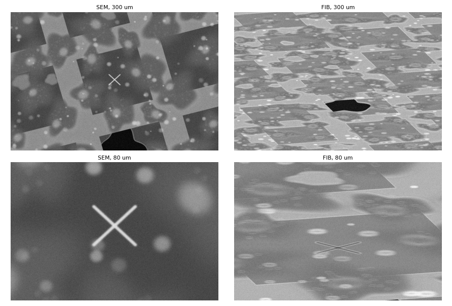
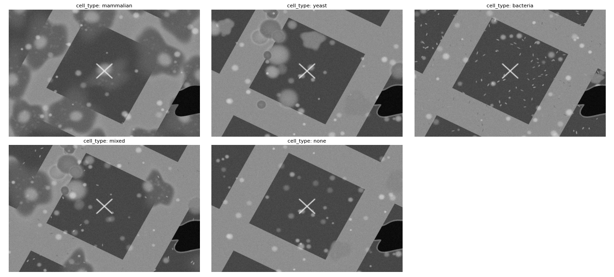
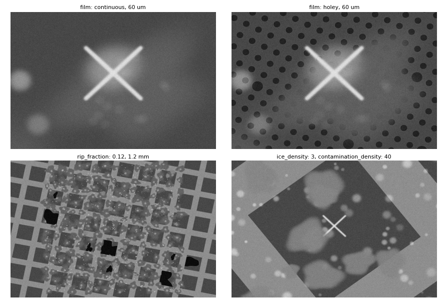
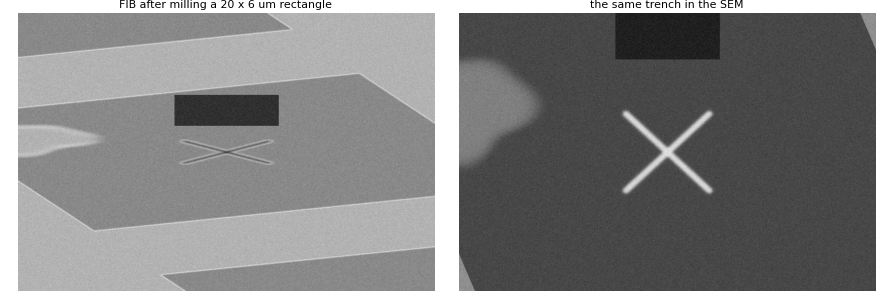
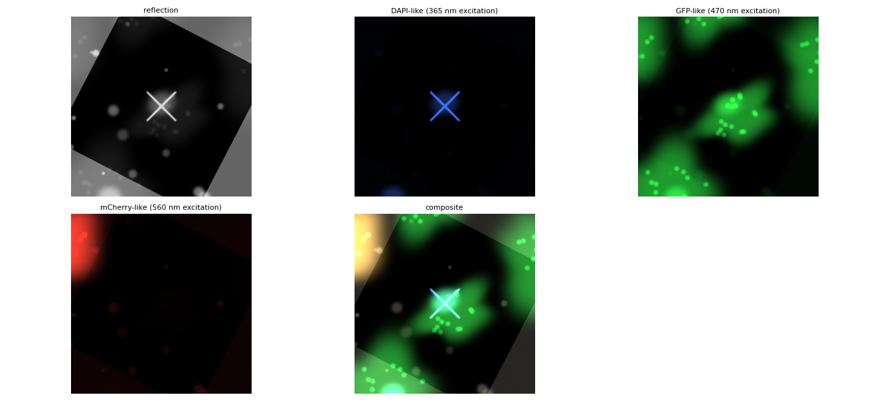
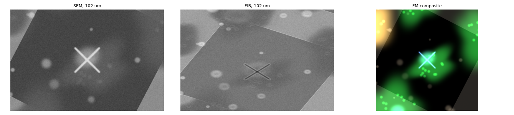
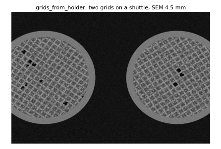

# The simulator

`manufacturer: Demo` in a microscope configuration connects to `DemoMicroscope`: a full
microscope in software. It has both beams, a fluorescence microscope where configured
(`sim.has_fm`, on by default for a compustage), a stage with the
same geometry model as the hardware drivers (pre-tilted shuttle or compustage), a sample
holder with slots and, when configured, an autoloader magazine. Every workflow, task and
UI runs against it unchanged, which is how most of fibsem-os is developed and tested.

With the **sample scene** on, the beams image a synthetic cryo-grid instead of noise: a mesh of bars and film with cells, contamination, ice and
rips on it, that both beams and the fluorescence camera see through their own
projections. The same world persists across stage moves, tilts, scan rotations and beam
shifts, so navigation, tiling, alignment and milling can be exercised for real.

## Turning the scene on

```yaml
sim:
    sample:
        enabled: true
        coincidence_offset: 8.0e-6      # height error at boot (m)
```

Everything else has a default. The two development configurations that ship,
[sim-arctis](../fibsem/config/sim-arctis-configuration.yaml) (compustage, with FM) and
[sim-iflm](../fibsem/config/sim-iflm-configuration.yaml), have the scene on with the
common keys spelled out; `microscope-configuration.yaml` (the shuttle Demo the tests run
on) leaves it off, so its beams return noise.

## What the beams see



The scene is one world on the sample plane. Each beam renders it through the same
`BeamStageProjection` the app uses to draw saved positions and stitch overviews, so the FIB
view is foreshortened by the beam's angle to the surface, a height error shows as a
vertical displacement between the views (what the coincidence alignment measures), scan
rotation turns the content, and a beam shift moves it.

Contrast is per beam, not one image inverted for the other: cell bodies are bright mounds
in the SEM and read slightly darker than the film in the FIB with a bright outline (the
edge effect).

### The 3D sample

The beams see a sample built from objects that can lie under one another: grid bars, the
film, cells with a nucleus, one sheet of ice over them (standing up in a broad ridge over
each bar), and clumps of particles resting on the ice. A cut face shows what it was cut
from (ice, cell, nucleus). Milled edges have a bright rim, cut faces are curtained, a GIS
coat is a real layer that shows as a bright band along the top of a cut, and a damaged
lamella has jagged bites, wandering cracks or a torn hole in its face. The FM looks at
the same sample from above. In reflection a cell's dome has a bright ring round its foot
and broken fringes up its flank, ice across a film hole is a bright dot, and a milled
edge is bright and ragged. A dye through the whole cell is a soft glow that follows how
much cell there is, so a lamella is a bright band between its trenches, and fluorescence
is lost exactly where a cut removed it. Every cell type stands under
its own ice, a holey film has ice across its holes (none where one broke), and a crack
is a groove. No two cells are alike inside: nuclei differ in size and height and some are
lobed, and the cytoplasm holds the cell's lipid droplets (the ones the FM labels) and
anything from a few vesicles to a face full of them.

## Cell types



`cell_type` picks what grows on the film: `mammalian` (adherent, spread bodies with an
off-centre nucleus and organelle speckle), `rpe` (single domed cells standing apart;
the default), `yeast` (compact ovoids in
clusters, some budding), `bacteria` (dense small rods), `mixed`, or `none` for bare film.
Cell bodies are opaque: they hide the film, holes and bars under them.

## Film, rips, ice and contamination



- **Film**: `holey` by default, a Quantifoil-style lattice of round holes
  (`hole_diameter`, `hole_pitch`, a seeded few broken), or `continuous`. The holey lattice is a 4 um
  periodic pattern the fine-pass coincidence correlator can alias on; see the note below.
- **Rips**: a seeded fraction of squares (`rip_fraction`) has the film torn away. Each rip
  is its own tear (size, orientation, where it starts, how ragged), a square beside a
  ripped one rips more readily, and a bright curled edge rings each rip.
- **Ice** (`ice_density`): flat bright plates with an irregular outline.
- **Frost** (`frost_density`): patches of small bright grains.
- **Spheres** (`sphere_density`, `sphere_size`): dark round balls standing on the film.
- **Cracks** (`crack_density`): hairline cracks in the film, a dark wandering line (some
  branched) that doesn't open the film the way a rip does.
- **Contamination** (`contamination_density`): small bright specks over film and bars
  alike, the aperiodic content that breaks a mesh-pitch alias in real images.

## Charging and coating

An uncoated grid charges in the SEM (`charging`, 0 turns it off): cells, ice plates and
anything standing up off the film glow, the glow runs on along the scan lines, and
charged lines flicker. A longer dwell charges more. The Demo sputter coater and GIS coat
the sample: a sputter coat (`sputter_thickness`, 0.5 nm/s) takes most of the charging
away and brightens the SEM a little; a GIS coat (`gis_thickness`, 0.04 um/s with the
valve open) smooths the detail, reads brighter in the FIB, takes some charging away, and
is milled through like the rest. Set either thickness in the config for a grid that comes
in coated. The coat follows what is under it, so bars and cells keep their relief. It
grows in over a broken hole or a rip in the film, by about half its thickness from each
edge: a small hole closes, a large rip narrows. A trench milled before a deposition is
not filled in.

## Beam settings

The SEM and FIB images answer to the beam's settings, as the instrument's do
(`beam_optics`, false draws every image sharp):

- **Working distance.** Each beam is in focus at its eucentric height
  (`eucentric_height` in the configuration), give or take a small seeded error
  (`focus_fuzz`). A working distance away from that blurs the image, more the further
  it is and more at a small field of view. The Demo starts at the eucentric height, and
  its autofocus finds the true focus.
- **Sample height.** Focus is where the sample is. A stage moved in z, or a sample that
  sits off the eucentric height (`coincidence_offset`), is that much nearer or further
  along the beam, so it needs its own working distance: autofocus after the move. Across
  a view the beam grazes, one edge is nearer than the other, so at a large field of view
  the top and bottom are a little softer than the middle.
- **Stigmation.** Off zero, the blur is stretched one way; through focus it turns to the
  other way, as astigmatism does. Zero is right.
- **Beam current.** A higher current is a bigger probe, so a softer image with less
  noise; a lower one is sharper and noisier.
- **Dwell time.** A longer dwell is less noise, a shorter one more, between half and
  four times the counts of a 1 us dwell.
- **Beam shift** moves the image, as it always has.

Voltage changes nothing, and the height of a cell or the depth of a trench is too
little to change focus.

## Starting wrong

A session can start with something set wrong, to practise noticing it:

- `scan_rotation_at_start: {electron: 180}` boots a beam at that scan rotation (degrees)
  whatever the configuration's default is. An overview taken then, and looked at after
  the rotation is put right, has its positions point-reflected.
- `fm_camera_mount: flip-x` (or `flip-y`, `flip-xy`) is how the FM camera is really
  mounted. Unless the camera's `mount_transform` in the configuration says the same, the
  FM image is flipped and a click on it sends the stage the wrong way.

## Things going wrong

`faults` is a list of things that go wrong during a session, each once, on a count of
images, milling passes, stage moves or valve openings from the start:

```yaml
sim:
  sample:
    faults:
      - {kind: beam_off, beam: ion, at: 3}             # the third FIB image
      - {kind: mill_drift, at: [2, 5], amount: 4e-7}   # a pass from 2 to 5, by the seed
      - {kind: stage_fails, at: 10}                    # the tenth stage move
```

| kind | counts | what happens | `amount` |
| -- | -- | -- | -- |
| `beam_off` | images, or passes with `on: mill` | the beam turns off: black frames until it is turned on, and a pass mills nothing | |
| `current_drop` | images, or passes with `on: mill` | the beam current falls to this fraction | 0.3 |
| `charging` | images | this frame charges that much more | 3.0 |
| `blank_image` | images | this frame is black | |
| `noisy_image` | images | this frame has that many times the noise | 6.0 |
| `stage_fails` | stage moves | the move raises and the stage stays where it was | |
| `stage_off` | stage moves | the stage lands that far off in x (m) and reads as if it had not | 5e-6 |
| `gis_closed` | valve openings | the valve does not open and nothing is laid down | |
| `mill_drift` | passes | this pass drifts that much more (m), up the image | 3e-7 |

With `beam: electron` or `beam: ion` a fault counts that beam's images or passes only.
What fired is logged and kept: `scene.faults_fired()`, and `faults` in `scene.record()`.

## Milling leaves marks



When milling runs, the drawn patterns are committed to the world as trenches (polygons on
the surface, so a rectangle rotated in the FIB view lands where the surface has it). From
then on every view, either beam, any tilt, shows them.


### Milling is not perfect

Each milling pass drifts by a seeded offset (`mill_drift`) and its patterns cut a little
past their edges (`mill_overcut`), more at higher current (`mill_kerf`: half the spot
size). A pattern cuts only as deep as its `depth`: short of the bottom it leaves a floor.
The trench walls lean in going down (`mill_taper`, degrees), so a lamella is thicker at
its bottom, and a cut face carries vertical curtaining stripes, strongest under bumps on
the top and mostly gone under a GIS cap (`curtaining`).

Every pass is recorded in `scene.mill_passes`: the drift, the current and kerf, the
planned gap between the trenches either side of its patterns' middle, the true gap left
(`gap`, narrowest; `gap_mean`), the gap at the patterns' depth (`gap_at_depth`), and any
damage. Below a seeded thickness (`damage_below`) each pass has a chance
(`damage_chance`) of starting damage, recorded in `scene.damage_started` (pass and kind):
a ragged front face, a crack across, or a piece broken out. It grows with every pass
after.
`damage_below` is the thickness at risk at a polishing current (`damage_current`, 60 pA).
A pass at a higher current puts a thicker lamella at risk, by the square root of the
ratio: at 1 nA a lamella four times as thick can break. It is less likely to the thicker
it is: the full chance holds below the usual thickness and falls to nothing at the limit
the current sets. Each pass records that limit and its chance (`damage_below`,
`damage_chance`), and `scene.damage_started` keeps the thickness, the limit, the chance
and the current of the pass that broke it.
A lamella that breaks while it is still thick breaks more coarsely: its cracks gape
wider, so a break in rough milling shows at a 50 um field of view.

### Imaging wears the sample

An ion beam image mills a little too. Each FIB frame puts down a dose, its current times
its dwell time times its pixels over its field of view, and takes that much ice off the
top (`imaging_damage`, 1 is ice at about 10 um3 per nC). At an imaging current it never
shows: a 20 pA frame at 40 um takes a fraction of a nanometre. At a milling current and
a small field of view it does: a 1 nA frame at 10 um takes about 0.2 um, and a few of
them leave a rectangle the size of the image. `scene.exposures` keeps the frames, the
dose (nC per um2) and the depth worn away for each field of view. The electron beam does
no damage.

`scene.record()` gives all of this as plain values for `json.dump`: the passes, every
milled region (its outline, depth, and whether it is a spot burn or damage), what
imaging wore away (`exposures`), and for
each fluorescence target whether it was milled away. Pass it points of your own,
`scene.record({"name": (x, y, z)})` (world metres, z above the film), to ask the same of
them.
## The fluorescence view



The FM camera images the same world through the FM projection, with a dye model keyed on
the excitation line: reflection shows the grid (bars bright, holes and rips dark, cells
faintly); a DAPI-like line lights nuclei and the fiducial; a GFP-like line the cell
bodies; an mCherry-like line a seeded subset of cells (`red_fraction`). Anything else
renders dark. The objective's distance from focus blurs the frame. The panels are shown
in the false colour a viewer gives each channel, and composited the way a CLEM overlay is.

Reflection comes from the same 3D sample the beams see. The bars
are brightest. The ice is a mid grey with fringes where its thickness changes, as a thin
film does. Cells read dark and textured, because their steep, rough surface scatters the
light away. Milling shows where the cut left material: a trench milled through is dark,
and a lamella or a floor shows fringes.

### FM labels and targets

Each FM channel carries one label, set per channel. Blue is always the nucleus (a DNA
dye) and the fiducial.

| Channel | Setting | Labels |
|---|---|---|
| green (488) | `fm_green` | `cytoplasm` (default: the whole cell, with the centrin pairs), `centrin` (centrin-GFP: the pairs and pools, the cell only faint), `lipid_droplets` |
| red (561) | `fm_red` | `subset` (default: a seeded subset of whole cells), `cilia` |
| far red (640) | `fm_far_red` | `none` (default), `membrane` (cell outlines), `mitochondria` |

A seeded fraction of cells (`fm_target_fraction`) are targets. Each has a centrin pool
with a centriole pair at its edge: two diffraction-limited spots about 1 um apart, at a
height in the cell. In a seeded share of those (`fm_cilium_fraction`) a primary cilium,
2-5 um long and about 250 nm wide, grows from the mother centriole in a random direction,
from lying flat to leaning steeply up. A seeded chance (`fm_no_target_chance`) leaves a
grid with no targets.

Points, rods, granules, droplets and mitochondria each sit at their own height: sharp
within about `fm_axial_range` of it, spreading and dimming either side, so a z-stack finds
each over a few planes. Whatever a milled pattern cut through, along the beam that milled
it, is gone from the FM, so a lamella keeps only what lies in its slab (the pattern's
depth is not applied here); the membrane is gone wherever a pattern milled.

On a tilted sample (an FM that shares the beams' point, with the stage at the milling
angle) the FM looks along a slanted line. A point over the plane shows further along the
view by its height, a cut dims only what lies along each line of sight, so a target a
slanted cut left standing is not hidden under the trench's outline, and the plane is in
focus along one line across the view, blurring away from it either side.
Every channel takes the same line: in reflection a trench and a raised top show where
that line first meets them, so the channels of one stack line up.

`scene.fm_targets()` lists each target: the pair's midpoint (x, y and height, m), its
two spots, its pool and its cilium's base and tip (or None). With `fm_red: cilia` it
lists only the cells with a cilium, and the midpoint is the cilium's. The camera has hot
pixels (`fm_hot_pixels`): the same pixels, as bright, in every frame.

## One world, three views



The same stage position through the three projections: the SEM looks down on the
surface, the FIB sees it foreshortened at its angle, and the FM camera images it through
its own tilt and transform. A feature clicked in one view is where the other two say it
is, because every view is drawn from one world through the app's own projection code.

## Grids at the holder's slots



With `grids_from_holder: true` the scene places one grid at every holder slot that has a
calibrated position and a loaded grid, centred where the slot's stage position falls,
and shows the holder between them. A grid's content is seeded from its name, so
exchanging grids between slots moves their cells with them. Off (the default), or with no
such slot, there is one grid centred on the position the stage was at when it connected.

To set a two-grid shuttle up on the Demo: calibrate the two slots with the holder
calibration wizard (Microscope tab, Sample Holder panel) at two stage positions a few
millimetres apart, put a grid in each slot, and set `grids_from_holder: true` in the
configuration's `sample:` block. The holder file is shared by every configuration in the
directory, which is why the option is per configuration.

## Coincidence and stage geometry

`coincidence_offset` is the height error the stage boots with: the SEM view barely
moves, the FIB view is displaced by the view tilt's worth, and the coincidence alignment
(Development menu) measures and removes it. `tilt_axis_offset` makes the stage
non-eucentric: the surface sits that far above the tilt axis, so a tilt change swings it,
which is what the tilt alignment corrects. `beam_offset` adds a persistent per-beam
lateral misalignment, and `current_offset_scale` a seeded offset per beam current, so the
milling-current alignment has something real to undo.

## Keys

All keys of the `sim: sample:` block, by what they control, with their defaults. Angles
are in degrees, ranges are two-element lists, lengths in metres.

<!-- sample-keys:start -->
### Stage and coincidence

| key | default | what it does |
| -- | -- | -- |
| `coincidence_offset` | 1e-05 | height error at boot (m): what the coincidence alignment corrects |
| `tilt_axis_offset` | 0 | how far the surface sits above the tilt axis (m); 0 is eucentric |

### Beams

| key | default | what it does |
| -- | -- | -- |
| `beam_offset` | {} | per-beam misalignment `{electron: [dx, dy], ion: [dx, dy]}` (m): a persistent lateral offset |
| `current_offset_scale` | 0 | sigma (m) of a seeded per-(beam, current) offset; 0 is off |
| `beam_optics` | true | working distance, stigmation and current show in the image (see Beam settings) |
| `focus_fuzz` | 15e-6 | how far a beam's focus is from its eucentric height, at most (m) |
| `scan_rotation_at_start` | {} | the scan rotation each beam boots at, `{electron: deg, ion: deg}` |
| `fm_camera_mount` | null | the mount transform the FM camera really has; null is as configured |
| `imaging_damage` | 1 | how fast FIB imaging wears the sample away (1 is ice, 0 is never) |
| `faults` | [] | things that go wrong and when, see "Things going wrong" |

### Grid and film

| key | default | what it does |
| -- | -- | -- |
| `grid_pitch` | 0.000125 | mesh pitch (m); 125 um is a 200 mesh |
| `grid_bar_width` | 3.5e-05 | bar width (m) |
| `grid_intensity` | 90 | how much reflected light from the bars leaks into a fluorescence channel |
| `grid_radius` | 0.0014 | usable film radius (m); past it the rim, then the holder |
| `grid_rim_width` | 0.00015 | the metal rim's width (m) |
| `grid_rotation` | unset | the grid's rotation (deg); random within the range when unset |
| `grid_rotation_range` | 45 | the random rotation's range (deg) |
| `film` | holey | `holey` (default, a Quantifoil-style lattice) or `continuous` |
| `hole_diameter` | 2e-06 | holey film: hole diameter (m) |
| `hole_pitch` | 4e-06 | holey film: hole pitch (m) |
| `broken_hole_fraction` | 0.006 | holey film: fraction of holes broken into larger openings |
| `fiducial` | False | a cross at each grid centre, a navigation landmark; absent on a real grid, so off by default |

### Cells

| key | default | what it does |
| -- | -- | -- |
| `cell_type` | rpe | `rpe` (default), `mammalian`, `yeast`, `bacteria`, `mixed`, `none` |
| `extent` | None | content is grown over +/- extent/2 about the grid centre, on the grid's disc (m); None fills the whole grid |
| `mammalian_density` | 7 | mammalian: cells per 150 x 150 um |
| `mammalian_radius` | [1.8e-05, 3e-05] | mammalian: body radius range (m) |
| `nucleus_radius` | [5e-06, 7e-06] | mammalian: nucleus radius range (m) |
| `n_clusters` | 120 | yeast: clusters per 800 x 800 um |
| `cells_per_cluster` | [3, 8] | yeast: cells per cluster (inclusive range) |
| `cell_size` | [4.5e-06, 1.2e-05] | yeast: sigma range per cell (m) |
| `cluster_spread` | 1.5e-05 | yeast: how far cells scatter round a cluster (m) |
| `bacteria_density` | 160 | bacteria: rods per 150 x 150 um |
| `bacteria_length` | [2e-06, 3.5e-06] | bacteria: rod length range (m) |

### Rips, ice and contamination

| key | default | what it does |
| -- | -- | -- |
| `rip_fraction` | 0.03 | fraction of squares with the film torn; neighbours rip more readily |
| `ice_density` | 0.4 | ice crystals per 100 x 100 um |
| `ice_size` | [6e-06, 1.6e-05] | ice plate radius range (m) |
| `contamination_density` | 15 | specks per 100 x 100 um, on film and bars alike |
| `contamination_size` | [8e-07, 3e-06] | speck sigma range (m) |
| `frost_density` | 0.15 | frost patches per 100 x 100 um |
| `sphere_density` | 0.4 | dark spheres per 100 x 100 um |
| `sphere_size` | [4e-07, 2e-06] | sphere radius range (m) |
| `crack_density` | 0.3 | hairline cracks in the film per 100 x 100 um |
| `mill_drift` | 2e-08 | sigma of each milling pass's drift (m) |
| `mill_overcut` | 3e-08 | how far past its edges a pattern may cut (m) |
| `mill_kerf` | true | a higher current cuts wider |
| `mill_taper` | 1.5 | degrees the trench walls lean in going down |
| `curtaining` | 1 | strength of the stripes down a cut face (0 = none) |
| `damage_below` | [1.5e-07, 3e-07] | the seeded thickness below which damage can start (m) |
| `damage_chance` | 0.4 | chance per pass below it that damage starts |
| `damage_current` | 6e-11 | the milling current `damage_below` is given at (A); 0 and the current makes no difference |
| `charging` | 1 | SEM charging strength on an uncoated grid (0 = never) |
| `gis_thickness` | 0 | GIS coat the grid starts with (m) |
| `sputter_thickness` | 0 | sputter coat the grid starts with (m) |

### Noise

| key | default | what it does |
| -- | -- | -- |
| `noise_sigma` | 12 | gaussian noise on the final image |
| `noise_fraction` | 0.15 | blend of full-range uniform noise (0-1) |

### Fluorescence

| key | default | what it does |
| -- | -- | -- |
| `red_fraction` | 0.4 | fraction of cells carrying the subset (mCherry-like) dye |
| `fm_blur_px_per_um` | 0.6 | FM defocus blur, pixels per micron the objective is off focus |
| `fm_target_fraction` | 0.5 | cells with a centrin pool and a centriole pair |
| `fm_no_target_chance` | 0.2 | chance a grid carries no pair at all |
| `fm_axial_range` | 5e-07 | how far from its height an FM spot stays sharp (m) |
| `fm_hot_pixels` | 0.0002 | fraction of FM camera pixels that are hot |
| `fm_green` | cytoplasm | green label: cytoplasm, centrin or lipid_droplets |
| `fm_red` | subset | red label: subset or cilia |
| `fm_far_red` | none | far-red label: none, membrane or mitochondria |
| `fm_cilium_fraction` | 0.7 | of the target cells, those with a primary cilium |

### Holder

| key | default | what it does |
| -- | -- | -- |
| `grids_from_holder` | False | grids at the holder's calibrated, occupied slots (opt-in) |

### Reproducibility

| key | default | what it does |
| -- | -- | -- |
| `seed` | 24 | the draw everything grows from; same seed, same scene |
<!-- sample-keys:end -->

## Cost and limits

- A frame renders in about 0.3 s at 1536 x 1024 once a place has been imaged; the first
  frame somewhere new costs 0.4-2 s (the world is stamped into cached tiles, then sampled
  per view). The fluorescence view is stamped per frame, about 0.4 s.
- The SEM to FIB coincidence measurement (an option, off in the workflow by default) was
  calibrated on an older, flat renderer. On the 3D sample its gates refuse many correct
  measurements, cells bias it by about a micron, and the holey film's 4 um lattice can
  alias it. Its simulator tests measure on a scene without cells.
- The scene is generated fresh from its seed on every connect. The same seed gives the
  same grid; milled trenches do not survive a reconnect.

The figures on this page are rendered with `fiducial: true` (a landmark for the eye;
off by default) by
[`render_simulator_examples.py`](developers/render_simulator_examples.py) from the current
code, and the key tables are read from the scene's defaults; rerun it after changing the
simulator.
